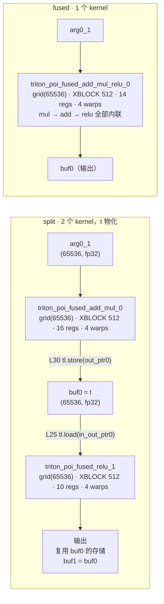

# 一条边的两种编译结果（课堂展示用）

对象：`P1-n65536-f32-contig-t`，s 表达式 `t = x*1.25+0.25; y = relu(t)`，fp32，连续布局。
数据来自 `runs/pilot-4060-local/artifacts/P1-n65536-f32-contig-t/`（本地 4060 冒烟；
3090 Ti 上以同一命令重跑，行号可能变，判定字段不变）。



## 源码片段

split 的两个 kernel 各自只含边的一侧（`output_code.py`）：

```python
# kernel 0: Source Nodes [mul, t] · ATen [aten.mul, aten.add]
tmp4 = tmp2 + tmp3
tl.store(out_ptr0 + (x0), tmp4, None)          # L30  t 写出

# kernel 1: Source Nodes [relu] · ATen [aten.relu]
tmp0 = tl.load(in_out_ptr0 + (x0), None)        # L25  t 读回（同一块存储）
tmp1 = tl.where(0*tmp0 < tmp0, tmp0, 0.0)
tl.store(in_out_ptr0 + (x0), tmp1, None)
```

wrapper（同一个 Python 调用内两次发射）：

```python
buf0 = empty_strided_cuda((65536, ), (1, ), torch.float32)      # L130  t 的分配
triton_poi_fused_add_mul_0.run(arg0_1, buf0, 65536, grid=grid(65536), stream=stream0)
buf1 = buf0; del buf0  # reuse                                    # L134  存储移交给消费者
triton_poi_fused_relu_1.run(buf1, 65536, grid=grid(65536), stream=stream0)
return (buf1, )
```

fused 只有一个 kernel，`t` 没有对应的 store/load：

```python
tmp0 = tl.load(in_ptr0 + (x0), None)     # x
tmp2 = tmp0 * 1.25
tmp4 = tmp2 + 0.25                      # t 只存在于寄存器
tmp5 = tl.where(0*tmp4 < tmp4, tmp4, 0.0)
tl.store(out_ptr0 + (x0), tmp5, None)     # 直接写输出
```

## 归约边（R1，M=256，K=512）

| | split | fused |
|---|---|---|
| kernel 0 | `triton_per_fused_sum_0`，persistent reduction，grid(256)，14 regs，16 B shared，`L35 tl.store(out_ptr0…)` 写 `buf0`(256, fp32) | `triton_per_fused_relu_sum_0`，grid(256)，14 regs，16 B shared |
| kernel 1 | `triton_poi_fused_relu_1`，grid(256)，`XBLOCK 256`，8 regs，`L25 tl.load(in_out_ptr0…)` 读回并按 relu 写回 | —（relu 作为归约的 epilogue 在同一 kernel 内） |

## 对照：默认策略与控制手段

| 手段 | P1 | 结论 |
|---|---|---|
| default（不干预） | 1 kernel，`stage=lowering`（调度器 0 次询问），`default_maps_to=fused` | 默认选择就是跨边融合，且在 lowering 阶段完成 |
| default（R1） | 1 kernel，`stage=scheduler`（2 次配对） | 归约边由调度器合并，与 P1 不同 pass |
| split（lowering realize + 调度器否决） | 2 kernel，t 物化 | 主候选 |
| 仅调度器否决 | 0 次否决命中、1 kernel | 2.6 的 pointwise 链在 lowering 阶段已内联 |
| `.clone()` | 1 kernel | 克隆本身被内联，不能切边 |
| `max_fusion_size=0` | 1 kernel（P1）/2 kernel（R1） | 全局开关只影响调度阶段，非边级控制 |
| `graph_break()` | 2 个编译图、1 次断裂 | 多一次 Python 入口调用，违反单图入口 |

对应机器可读记录：`variants.jsonl`（状态、kernel 数、`edge_verdict`、`default_maps_to`、
`unrelated_partition_change`）与 `artifacts/<case>/<strategy>/edge_evidence.json`
（写/读行号、buffer、grid、静态资源、命中日志）。
