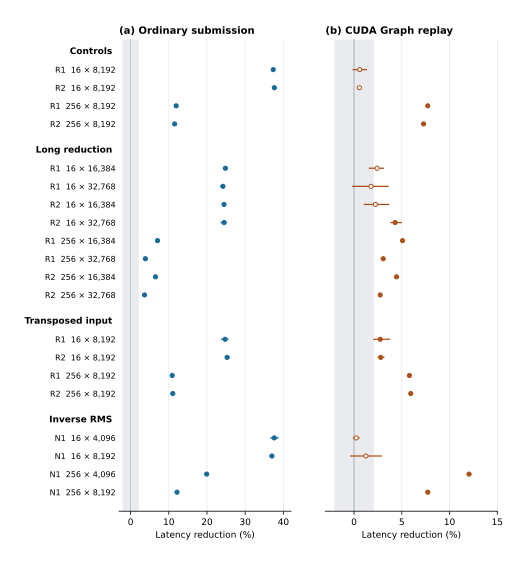
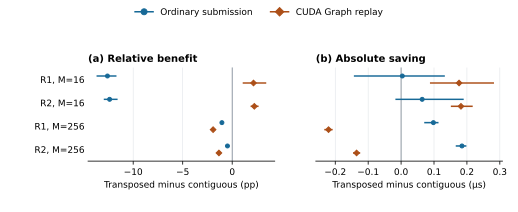
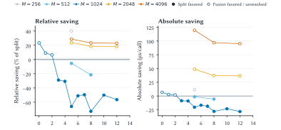

# TorchInductor 局部融合的收益随提交模式与输入布局变化

## 摘要中的结果段

我们在固定版本的 TorchInductor 中为同一条生产者–消费者边构造融合与拆分候选，并在 RTX 3090、RTX 4090 和 H800 PCIe 上配对测量。RTX 3090 补采的 20 个归约配置在普通 CUDA 提交下均明确受益于融合，相对延迟下降 3.7%–37.6%。改用 CUDA Graph replay 后，明确受益的配置减至 13 个，按配置计算的绝对收益中位数从 2.36 降至 0.68 µs。四组同形状布局对照中，转置输入使普通提交下的相对降幅减少了 0.48–12.60 个百分点，绝对节省量的点估计均持平或略增。在 72 配置主网格与补采中，明确标签均指向融合；两项代价模型与 Inductor 默认策略表现相同，但所有 clear label 均为融合且默认始终融合，该比较不能区分策略在拆分占优边上的能力。在一个 epilogue 负载随平移读数量 $B$ 增长的压力家族中，24 个已测点包含 10 个拆分占优；相对差最大为 72.9%（$M=1024,B=8$，28.00 µs），绝对差最大为 28.32 µs（$B=12$，56.4%）；$M=512$ 最大为 5.65 µs（21.5%）。

## 实验设计与度量

使用 PyTorch 2.6.0+cu124 和 Triton 3.2.0。RTX 3090 与 RTX 4090 各测相同的 72 个原始配置；H800 PCIe 测 12 个在 H800 采集前固定、但在 4090 分析后选定的定向困难配置（含 4090 上三项模型的两个错例）。RTX 3090 补采包含 8 个长归约、4 个转置输入和 4 个逆 RMS 因子配置，另重测 4 个原始配置作为同期连续布局对照。补采共 20 个配置，覆盖 60 个编译变体且均通过数值与切边检查。另有一个在 RTX 4090 上采集的压力家族，共 24 个配置：行和之后接宽度为 $B$ 的平移读 epilogue，split 仍是同一入口的 `realize(t)` 加调度器否决。对每个配置分别采集普通 CUDA 提交与 CUDA Graph replay，每种方式取 30 个配对区块，平衡 split/fused 的先后顺序并随机打乱。

延迟为 CUDA event 区间折算出的每次调用平均时间。记 $\Delta=T_{\mathrm{split}}-T_{\mathrm{fused}}$，负值表示拆分更快；相对收益为 $\Delta/T_{\mathrm{split}}$。以完整配对区块为重采样单位，用 10,000 次 bootstrap 计算逐配置 95% 区间。区间整体高于 $+2\%$ 或低于 $-2\%$ 时，分别判为融合占优或拆分占优。区间整体落入 $[-2\%,+2\%]$ 时判为近似等价，其余判为未定。

## 结果一 · 普通提交的融合收益在 replay 中减弱

RTX 3090 补采的 20 个配置在普通提交下均达到融合占优判据，绝对节省 1.52–3.18 µs/次调用。在 CUDA Graph replay 下，融合占优、近似等价、未定的配置分别为 13、3、4 个。20 个配置的绝对收益点估计在 replay 中都低于普通提交，对应中位数由 2.36 µs 降至 0.68 µs。补采编译证据显示，融合在每个配置上都少启动一个 kernel。补采正式采集的启动校准斜率由普通提交的 6.54 µs/kernel 降至 replay 的 0.91 µs/kernel。这两组观察与提交开销下降的解释一致，$B$ 同时包含生成代码、调度和中间张量访问的变化。

对固定 $M=256$ 的连续 FP32 R1/R2 归约，将归约长度 $K$ 从 8,192 增至 32,768 时，普通提交下的相对收益从 11.5%–11.9% 降至 3.7%–3.9%，两端均达到融合占优判据。逆 RMS 因子配置的普通提交降幅为 12.2%–37.6%。例如，$M=256, K=8{,}192$ 时，拆分路径使用两个 kernel 写出并读回行均方，融合路径合并为一个 kernel，延迟从 13.067 µs 降至 11.479 µs，降幅 12.15%（95% 区间 12.13%–12.17%）。

以不同的采集顺序种子复跑了 4 个选定配置。8 个配置与提交模式组合的收益点估计符号一致，降幅差的绝对值最大为 0.80 个百分点。7 个组合保留了原标签。R2（$M=16,K=8{,}192$，连续 FP32）的 replay 降幅由 0.56% 变为 1.05%，标签由近似等价变为未定。把判据改为 ±1% 和 ±5% 后，补采的融合占优计数分别为普通提交 20/20 和 18/20，replay 15/20 和 7/20。两种判据下观察到的明确优胜策略仍全部是融合。

**图 1.** RTX 3090 补采的逐配置相对延迟降幅。点为估计值，横线为逐配置配对 bootstrap 的 95% 区间。灰带表示 ±2% 的实际等价区间，实心点表示融合占优，空心点表示近似等价或未定。行标签给出模板、输出行数 $M$ 和归约长度 $K$。两个面板的横轴刻度不同。

## 结果二 · 转置输入降低了相对收益，绝对收益取决于提交模式和行数

在固定 FP32、$K=8{,}192$ 的四组形状匹配对照中，普通提交的转置输入使相对收益减少 0.48–12.60 个百分点。以 R1 的 $M=16$ 为例，连续和转置输入的拆分延迟分别为 8.281 和 12.514 µs，融合分别节省 3.092 和 3.096 µs。因此，近乎相同的绝对节省对应 37.34% 与 24.74% 的相对降幅。在 $M=16$ 时，两种模板的绝对差区间均包含零。在 $M=256$ 时，绝对节省的点估计增加 0.10 和 0.19 µs。

在 replay 中，转置输入使 $M=16$ 的绝对节省增加 0.176–0.182 µs，使 $M=256$ 的绝对节省减少 0.135–0.220 µs。在这四组形状匹配对照上，同时报告微秒与百分比有助于解释布局改变后的融合收益。

**图 2.** 固定模板、$M$、$K=8{,}192$ 和 FP32 后，转置输入相对于同期连续对照的融合收益变化。左图单位为百分点，右图单位为 µs/次调用。正值表示转置输入条件下的融合收益更大。区间通过分别重采样两种布局下的完整配对区块获得，是逐对照的 95% 区间。

## 结果三 · 跨设备验证中的默认策略与代价模型

**表 1.** 主实验的标签数。各模式按同一批配置统计，补采包含 4 个同期对照。H800 PCIe 的统计对应 12 个定向困难配置（含 4090 两个模型错例）。

| 数据 | 配置数 | 普通提交（融合 / 等价 / 未定 / 拆分） | Replay（融合 / 等价 / 未定 / 拆分） |
|---|---:|---:|---:|
| RTX 3090 原网格 | 72 | 68 / 3 / 1 / 0 | 25 / 33 / 14 / 0 |
| RTX 4090 原网格 | 72 | 68 / 4 / 0 / 0 | 27 / 7 / 38 / 0 |
| H800 PCIe 子集 | 12 | 12 / 0 / 0 / 0 | 7 / 0 / 5 / 0 |
| RTX 3090 补采 | 20 | 20 / 0 / 0 / 0 | 13 / 3 / 4 / 0 |

在 RTX 3090 和 RTX 4090 的同一 72 个配置上，普通提交下有 71 个配置得到相同标签，其中 68 个共同判为融合占优。两卡在 replay 下分别有 25 和 27 个配置判为融合占优，其中 13 个共同判为融合占优。进一步限制在三卡共同的 12 个配置上，RTX 3090、RTX 4090 和 H800 PCIe 在普通提交下分别有 10、10 和 12 个融合占优配置，在 replay 下分别有 2、6 和 7 个。实测设备间的标签差异在 replay 中更明显。

用 RTX 3090 原始数据拟合模型，在各验证 run 上先用独立的拆分计时冻结预测，再进行正式配对。两项模型与 Inductor 默认策略在两个目标 GPU 及 RTX 3090 补采上的明确标签准确率相同，平均错选耗时（regret）也相同；但所有 clear label 均为融合且默认始终融合，这是构造上的平局，不能说明模型对拆分占优边的识别能力。RTX 4090 的 replay 中，两项模型、默认策略及恒选融合均为 27/27，平均 regret 为 0.00583 µs/次调用。三项模型有两次明确错选，为 25/27，平均 regret 为 0.01861 µs/次调用。RTX 3090 补采中，两项模型覆盖全部 20 个配置，三项模型因资源特征缺失每种模式覆盖 12 个配置。本语料上的高准确率与明确标签全部指向融合一致，检验反向决策需要拆分占优样本。

## 结果四 · 扩大 epilogue 负载后出现拆分占优区

为检验“融合在什么条件下会亏”，构造了单边压力家族：$t=\sum_k x_{m,k}$，$y_{m,k}=t_m\,(x_{m,k}+\sum_{s=1}^{B}x_{m,k+s})$（行内下标取模），每个平移读是一次独立的 load。在 RTX 4090（torch 2.6.0+cu124、Triton 3.2.0）上，24 个配置中 10 个拆分占优、13 个融合占优、1 个未定；每种配置取 30 个配对区块（$B=3$ 取 60 个），正反顺序交替，10,000 次 block bootstrap。

24 个已测点中，$M\in\{512,1024\}$、$K=8192$、FP32、$B\ge 3$ 的 10 个已测点均拆分占优；但 $M=512$ 只测了 $B=5,8$，$M=1024$ 缺 $B=9,11$，区域边界未采样。最大相对差为 $M=1024,B=8$：融合 66.42 µs、拆分 38.42 µs，拆分快 28.00 µs（95% 区间 27.86–28.14 µs），相对 72.9%。最大绝对差为 $B=12$：−28.32 µs（−28.45 至 −28.17），相对 56.4%。$B=3$ 与 $B=5$ 分别为 −8.70 µs（−8.78 至 −8.62）与 −20.42 µs（−20.52 至 −20.31）；交叉点在 $B=2$（+1.89 µs，+6.4%）与 $B=3$ 之间。

该区域窄且非单调。$M=256,B=5$ 融合快 11.38 µs（40.2%）；$M=2048$ 在 $B=5,8,12$ 分别快 48.70、37.16、36.65 µs；$M=4096,B=5$ 快 119.62 µs（28.7%）。改变归约长度或类型也会消失：$M=1024,K=2048,B=5$ 融合快 12.21 µs，$K=4096$ 未定（+1.11 µs，区间 −0.98 至 3.52），同形状 FP16 融合快 6.77 µs。

机制由逐 kernel 时间与编译产物给出。fused kernel 的 epilogue 继承归约的 launch config（每行一个 program、`XBLOCK=1`、16 warps、grid=$M$），split 的消费者是独立点式 kernel（`XBLOCK=1024`、4 warps、grid=$MK/1024$）。$M=1024,K=8192$ 下，$B=0$ 时 fused 为 20.96 µs，split producer 8.77 µs、consumer 18.37 µs；$B=3$ 为 37.15 / 9.02 / 19.09；$B=5$ 为 50.26 / 8.76 / 20.55；$B=8$ 为 65.18 / 8.88 / 26.97。producer 恒为约 9 µs，split consumer 每个平移读约增 1 µs，fused kernel 约增 5 µs。第二层损失来自归约启发式：$M\ge1024$ 且 `num_load + num_reduction` 达到 10 时，`_reduction_configs` 置 `register_intensive`，`MAX_RBLOCK` 从 2048 降到 1024、warp 上限从 16 降到 8，并在 $B=10$ 选到 `RBLOCK=512`；split producer 保持 2048/16。$B=6$ 则是纯寄存器路径：fused 需 55 个寄存器、occupancy 0.67，split producer 需 26、occupancy 1.0。

静态资源代理无法定位该区域：10 个拆分占优配置中有 8 个的 $o_s-o_f=0$（$M=1024$ 的 $B=3,4,5,7,8,10,12$ 与 $M=512,B=5$），而 $M=4096,B=8$ 的 $x_3=+69.3$ µs 却仍由融合快 97.0 µs。符号取决于 epilogue 是否继承归约 tile，而不是驻留容量本身。

**图 3.** RTX 4090 压力家族的融合收益。横轴为 epilogue 的平移读数量 $B$；纵轴为 split−fused 的相对收益（左）与绝对时间（右），须为配对 95% 区间。实心点为拆分占优，空心点为融合占优或未定。全部为 FP32、$K=8192$，颜色区分行数 $M$。

## 适用范围

本文报告的是 PyTorch 2.6.0 上由显式切边构造的单消费者局部融合，逆 RMS 因子的测量止于 `rsqrt` 输出。GPU 型号、宿主机、驱动和软件补丁版本在跨卡比较中同时变化。H800 的结论限于 12 个定向困难配置（含 4090 两个模型错例）。硬件计数器缺失使 DRAM/L2 流量与实际 occupancy 的解释仍需验证。72 配置主网格与补采中没有拆分占优；4090 上的压力家族给出了一个窄的、非单调的拆分占优点集（$M\in\{512,1024\}$、$K=8192$、FP32、$B\ge3$ 的 10 个已测点，最大相对差 −72.9%），边界未采样。该区域只在一台设备、一个家族上测得，未使用硬件计数器；不能据此主张融合普遍有害。
